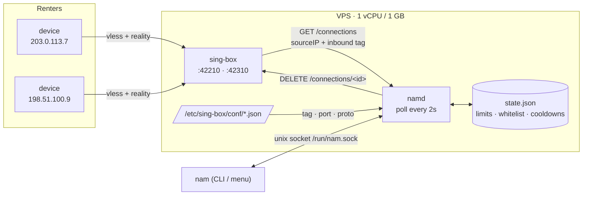
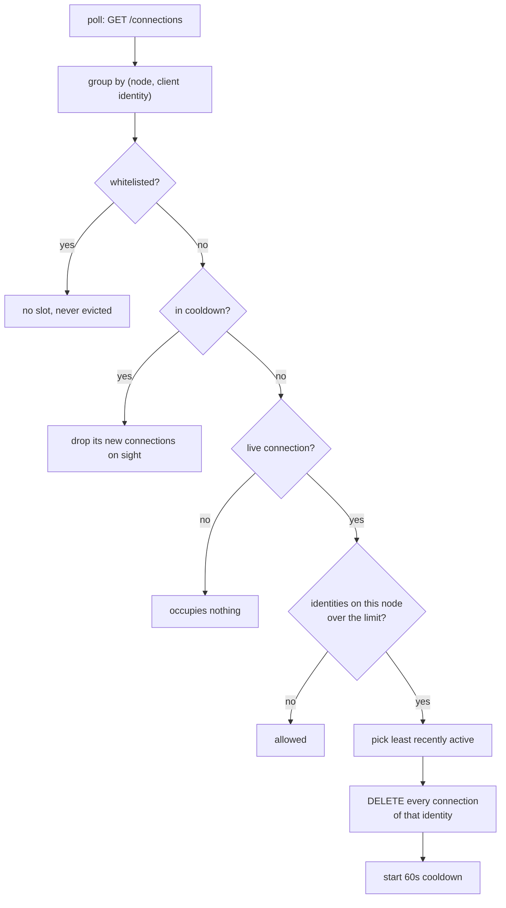
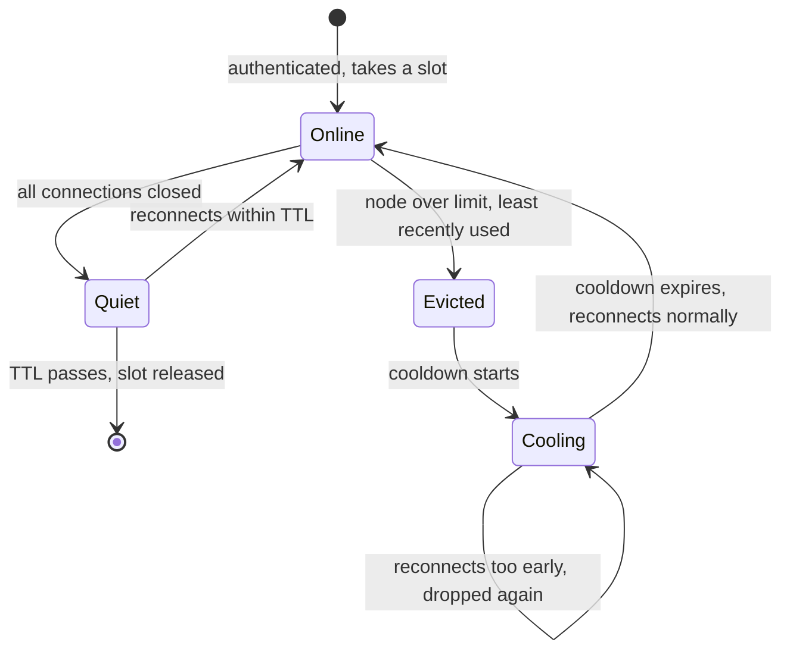
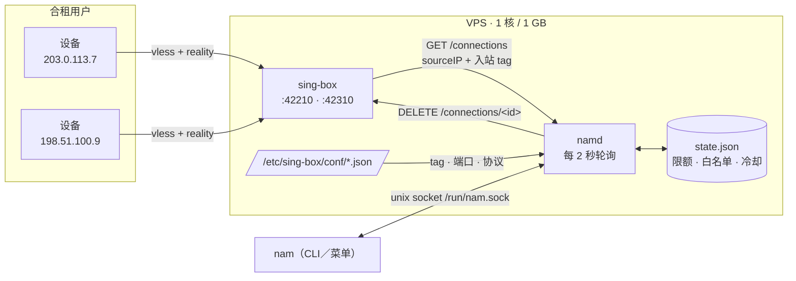
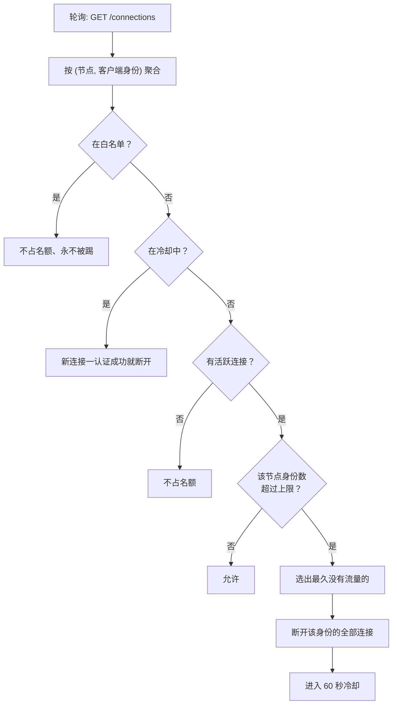
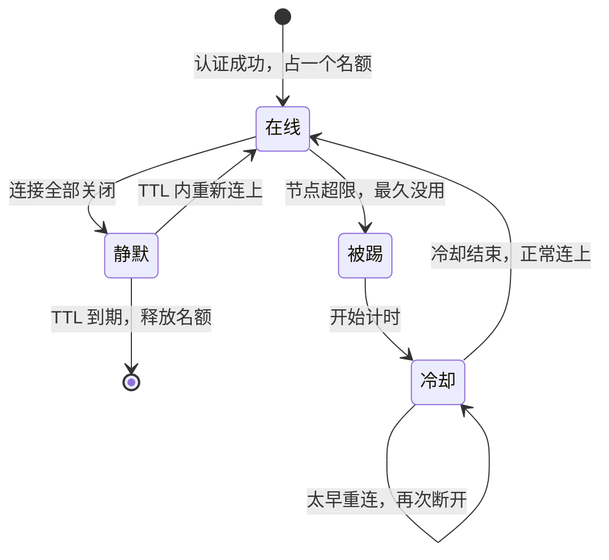

# NAM — Node Access Manager

Per-node IP concurrency control for [233boy's sing-box](https://github.com/233boy/sing-box) nodes.
One static binary, no dependencies, ~1 MB resident on a 1 vCPU / 1 GB server.

[English](#english) · [中文](#中文)

---

## English

### The problem

You run a few sing-box nodes on a small VPS and share them with friends. There is
no per-user account system, so nothing stops one person from forwarding the
subscription link to ten others. What you actually want is blunt and simple:

> **A node may have at most N distinct client IPs connected at the same time.
> When a new one appears, the least recently used one loses its slot.**

### Why not count TCP connections

Because accepting a connection proves nothing. On the machine this was built for,
a scanner completed tens of thousands of TCP handshakes and failed the REALITY
handshake every single time:

```
INFO  inbound/vless[...]: inbound connection from 203.0.113.9:39098
ERROR inbound/vless[...]: TLS handshake: REALITY: processed invalid connection
```

`ss`, `/proc/net/tcp` and `access.log` all count that as an online user, and it
would permanently hold one of five slots while kicking real people out.

`GET /connections` from the sing-box **Clash API** only lists sessions that
sing-box actually authenticated, and each entry carries the client address and
the inbound that served it:

```json
{"metadata":{"sourceIP":"203.0.113.7","type":"vless/VLESS-REALITY-42210.json"}}
```

That is the entire data source. NAM never parses logs, never runs `ss`, and never
touches your node configuration.

### Architecture



`namd` and `nam` are the same binary. The daemon owns all decisions; the CLI only
talks to it over a 0600 unix socket, so the two can never disagree about policy.

### Decision flow



### Identity lifecycle



Without the cooling state two clients on the same node would evict each other in
a loop: each reconnect looks "newer" than the other. Cooling makes the loser
actually wait, and it is deliberately per `(node, IP)` so one node's quota cannot
be spent blocking another.

### Identity = one client, not one connection

A single client held **45 simultaneous connections** to one node (one per target
of the browser). Connections are therefore aggregated by source IP before
counting. IPv6 is reduced to its `/64`, because clients rotate privacy addresses
inside their own prefix and would otherwise look like new users on every
reconnect.

### Quick start

```bash
make dist                        # dist/nam-linux-amd64 (static, ~5 MB)
scp dist/nam-linux-amd64 root@server:/root/nam-new
ssh root@server
chmod +x /root/nam-new && mv /root/nam-new /usr/local/bin/nam   # mv avoids ETXTBSY

nam setup                        # adds experimental.clash_api, keeps a .nam.bak
sb                               # → 5) manage → restart  (needed once)
nam doctor                       # every prerequisite, pass/warn/fail

cp systemd/nam.service /etc/systemd/system/
systemctl daemon-reload && systemctl enable --now nam
nam status
```

`nam setup` only fills in fields that are missing and never restarts sing-box by
itself. If `experimental.clash_api` already exists, it is left untouched.

### Commands

```bash
nam                                  # interactive menu
nam status [--json]                  # per-node table: IPs, traffic, activity
nam policy list
nam policy set 42210 3               # port or tag; clears that node's cooldowns
nam allow add 203.0.113.7            # never counted, never evicted
nam allow add 198.51.100.0/24
nam kick 203.0.113.7 --node 42310
nam doctor
```

Node arguments accept the inbound tag (`VLESS-REALITY-42210.json`) or the bare
port (`42210`), because operators think in ports while the API reports tags.

### Rules

| Rule | Behaviour |
| --- | --- |
| Counting | per node, per client identity; nodes are independent |
| Default limit | 5 slots; override per node, persisted |
| Eviction | least recently active first (last traffic → session start → address) |
| Cooldown | 60s; new sessions dropped on sight, identity never a victim |
| Whitelist | address or CIDR; occupies no slot and is never evicted |
| TTL | an identity with no live connection frees its slot immediately; the record is kept 30s for traffic deltas |
| Admin actions | changing a limit or whitelisting an IP clears its cooldown at once |
| Audit trail | every event also goes to stderr, so `journalctl -u nam` has history |

### Configuration

`/etc/nam/config.json` is optional; every field has a default.

```json
{
  "singbox_config": "/etc/sing-box/config.json",
  "singbox_conf_dir": "/etc/sing-box/conf",
  "socket": "/run/nam.sock",
  "state_file": "/var/lib/nam/state.json",
  "poll_seconds": 2,
  "online_ttl_seconds": 30,
  "cooldown_seconds": 60,
  "default_limit": 5,
  "ipv6_prefix": 64
}
```

The Clash API address and secret are **not** duplicated here: they are read from
sing-box's own `config.json` at startup, so there is a single source of truth.
After rotating the secret, `systemctl reload nam` (SIGHUP) is enough.

Policy lives in `/var/lib/nam/state.json`, written only by the daemon.

| Package | Responsibility |
| --- | --- |
| `internal/clash` | Clash API client: connections, close, capability probe |
| `internal/nodes` | conf-dir discovery and listener check from `/proc` |
| `internal/ipkey` | identity of an address (IPv4 as-is, IPv6 `/64`), CIDR matching |
| `internal/engine` | aggregation, victim selection, enforcement loop |
| `internal/state` | persisted limits, whitelist, cooldowns |
| `internal/ipc` | unix socket protocol the CLI speaks |
| `internal/ui` | status table (ANSI + tabwriter, no TUI dependency) |
| `internal/cfg` | own settings, Clash API extraction and injection |
| `cmd/nam` | daemon, CLI, menu, doctor, setup |

### Known limits

- Only sing-box inbounds are managed. Connections that reach sing-box through a
  relay (realm, nodepass, a CDN) arrive from `127.0.0.1` or from the relay's
  address, and cannot be attributed to a client IP.
- Sharing the same NAT is the same IP. A dual-stack client that uses both IPv4
  and IPv6 counts as **two** identities.
- This is a concurrency limit, not a quota. Two people using the same node at
  different times are never detected; that needs a time-windowed quota.
- `sb reinstall` and `sb fix-config.json` rewrite `config.json` and drop
  `experimental.clash_api`. `nam doctor` reports it; re-run `nam setup` and
  restart sing-box.
- A client that stays running keeps its connections (and therefore its slot)
  even while idle.

### Development

```bash
make check      # go vet + go test
make dist       # static linux/amd64 binary
```

Requires Go 1.22+. No third-party dependencies. Tested against sing-box 1.13.14
and 1.14.3 on Ubuntu; the Clash API has existed since 1.8.

---

## 中文

### 解决的问题

你在小 VPS 上跑几个 sing-box 节点，分给朋友用。sing-box 没有多用户账号体系，所以
拦不住某个人把订阅链接转给十个人。要的东西其实很直接：

> **一个节点同一时间最多允许 N 个不同的客户端 IP，超了就把最久没用的那个顶掉。**

### 为什么不用"连上端口"来数人

因为 TCP 连上了不代表是用户。这台机器上就有过这样的日志——扫描器成千上万次完成
TCP 握手、然后每次都在 REALITY 握手阶段失败：

```
INFO  inbound/vless[...]: inbound connection from 203.0.113.9:39098
ERROR inbound/vless[...]: TLS handshake: REALITY: processed invalid connection
```

`ss`、`/proc/net/tcp`、`access.log` 都会把它当成一个在线用户，它会永久占掉 5 个名额
里的 1 个，并且不停把真人踢掉。

sing-box **Clash API** 的 `GET /connections` 只列出真正认证成功的会话，每条都带客户端
地址和命中的入站：

```json
{"metadata":{"sourceIP":"203.0.113.7","type":"vless/VLESS-REALITY-42210.json"}}
```

这就是全部数据来源。NAM 不解析日志、不跑 `ss`、也不改你的节点配置。

### 架构



`namd` 和 `nam` 是同一个二进制。守护进程负责所有决策，CLI 只通过 0600 的 unix socket
跟它说话，所以两边永远不会对"当前策略"有不同理解。

### 判定流程



### 身份的生命周期



如果没有"冷却"这个状态，同一节点的两个客户端会互相顶来顶去：每次重连看起来都比对方
"更新"。冷却期让被踢的人真正等一下，而且是按 `(节点, IP)` 记的，所以 A 节点被踢不会
影响它在 B 节点的配额。

### 一个身份 ≠ 一条连接

实测中**一个客户端对单个节点持有 45 条并发连接**（浏览器每开一个目标就是一条）。
所以计数前先按源 IP 聚合。IPv6 按 `/64` 归并——客户端会轮换隐私地址，否则每次重连都
会被当成新用户。

### 快速开始

```bash
make dist                        # 产出 dist/nam-linux-amd64（静态，约 5 MB）
scp dist/nam-linux-amd64 root@服务器:/root/nam-new
ssh root@服务器
chmod +x /root/nam-new && mv /root/nam-new /usr/local/bin/nam   # 用 mv 避开 ETXTBSY

nam setup                        # 写入 experimental.clash_api，会留 .nam.bak
sb                               # → 5) 运行管理 → 重启  （需要一次）
nam doctor                       # 逐项自检：通过／警告／失败

cp systemd/nam.service /etc/systemd/system/
systemctl daemon-reload && systemctl enable --now nam
nam status
```

`nam setup` 只补缺失字段，不会自己重启 sing-box；已经存在 `experimental.clash_api`
就原样保留。

### 命令

```bash
nam                                  # 交互菜单
nam status [--json]                  # 各节点在线 IP、流量、活跃时间
nam policy list
nam policy set 42210 3               # 端口或 tag；同时清掉该节点冷却
nam allow add 203.0.113.7            # 不计数、不被踢
nam allow add 198.51.100.0/24
nam kick 203.0.113.7 --node 42310
nam doctor
```

节点参数既可以写 tag（`VLESS-REALITY-42210.json`）也可以直接写端口（`42210`），
因为人按端口思考，而 API 报的是 tag。

### 规则

| 规则 | 行为 |
| --- | --- |
| 计数 | 每个节点、每个身份独立计数，节点之间互不影响 |
| 默认上限 | 5 个名额，可按节点覆盖并持久化 |
| 顶人顺序 | 最久没有流量优先（最后活跃 → 会话开始 → 地址） |
| 冷却 | 60 秒；期间新连接一认证成功即断，且不参与顶人 |
| 白名单 | 地址或 CIDR，不占名额、不被踢 |
| TTL | 没有活跃连接的身份立即释放名额，记录保留 30 秒用于算流量差 |
| 管理动作 | 改限额或加白名单会立即解除对应冷却 |
| 审计 | 所有事件同时写 stderr，`journalctl -u nam` 里有历史 |

### 配置

`/etc/nam/config.json` 可选，每个字段都有默认值。

```json
{
  "singbox_config": "/etc/sing-box/config.json",
  "singbox_conf_dir": "/etc/sing-box/conf",
  "socket": "/run/nam.sock",
  "state_file": "/var/lib/nam/state.json",
  "poll_seconds": 2,
  "online_ttl_seconds": 30,
  "cooldown_seconds": 60,
  "default_limit": 5,
  "ipv6_prefix": 64
}
```

Clash API 的地址和 secret **不在这里重复配置**：启动时从 sing-box 自己的 `config.json`
读，保持单一事实来源。换了 secret 之后 `systemctl reload nam`（SIGHUP）即可。

策略存在 `/var/lib/nam/state.json`，只由守护进程写入。

| 包 | 职责 |
| --- | --- |
| `internal/clash` | Clash API 客户端：连接列表、断连、能力探测 |
| `internal/nodes` | 读 conf 目录发现节点，用 `/proc` 校验是否在监听 |
| `internal/ipkey` | 地址的身份（IPv4 原样、IPv6 `/64`）与 CIDR 匹配 |
| `internal/engine` | 聚合、选受害者、执行循环 |
| `internal/state` | 持久化限额、白名单、冷却 |
| `internal/ipc` | CLI 与守护进程之间的 unix socket 协议 |
| `internal/ui` | 状态表（ANSI + tabwriter，不引入 TUI 框架） |
| `internal/cfg` | 自身配置、Clash API 的读取与注入 |
| `cmd/nam` | 守护进程、CLI、菜单、doctor、setup |

### 已知边界

- 只管 sing-box 的入站。经 realm / nodepass / CDN 中转进来的连接，源地址是
  `127.0.0.1` 或中转机地址，无法归属到具体客户端 IP。
- 同一个 NAT 后面的多个人算同一个 IP。双栈客户端同时用 IPv4 和 IPv6 会算成**两个**
  身份。
- 这只是并发限制，不是配额。两个人错开时间轮流用同一个节点是检测不到的，那需要
  时间维度的统计。
- `sb reinstall` 和 `sb fix-config.json` 会重写 `config.json`、丢掉
  `experimental.clash_api`。`nam doctor` 会报出来，重跑 `nam setup` 再重启 sing-box
  即可。
- 客户端只要还开着，即使没人用也会因为连接还在而占着名额。

### 开发

```bash
make check      # go vet + go test
make dist       # 静态 linux/amd64 二进制
```

需要 Go 1.22+，无第三方依赖。已在 sing-box 1.13.14 与 1.14.3 上验证；Clash API 自
1.8 起就存在。
